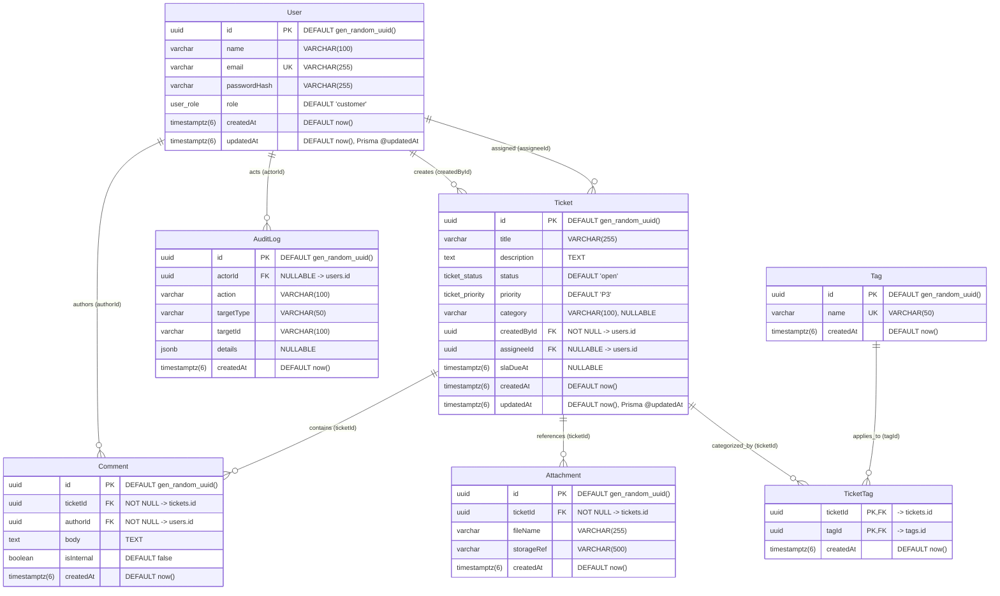

# SupportDesk — Database Design Notes (Day 8)

> **Notice:** This document specifies the Day 8 educational demo database design for the SupportDesk project. It is intended to establish clean relational foundations and Prisma conventions for core ticketing operations. It is not an enterprise-certified, fully production-hardened architecture.

---

## 1. Database Overview

The SupportDesk application utilizes a relational database architecture powered by **PostgreSQL** and modeled with **Prisma ORM**. The data model establishes foundational capabilities for helpdesk operations, including user identity management, customer ticket submission, agent ticket assignment, conversational message threads, file attachment references, many-to-many tag classification, and an audit trail.

---

## 2. Entity Relationship Diagram (ERD)



---

## 3. Enum Values and Prisma Mappings

To maintain idiomatic TypeScript conventions (`PascalCase` identifiers) while storing exact lowercase/alphanumeric strings in PostgreSQL, Prisma’s `@map` attribute is used:

### 3.1 User Role (`user_role`)
- `CUSTOMER` -> `@map("customer")`
- `AGENT` -> `@map("agent")`
- `ADMIN` -> `@map("admin")`

### 3.2 Ticket Status (`ticket_status`)
- `OPEN` -> `@map("open")`
- `IN_PROGRESS` -> `@map("in_progress")`
- `WAITING_ON_CUSTOMER` -> `@map("waiting_on_customer")`
- `RESOLVED` -> `@map("resolved")`
- `CLOSED` -> `@map("closed")`

### 3.3 Ticket Priority (`ticket_priority`)
- `P1` -> `@map("P1")`
- `P2` -> `@map("P2")`
- `P3` -> `@map("P3")`
- `P4` -> `@map("P4")`

---

## 4. Entity & Field Specifications

### Timestamp Precision Standard
All timestamp columns across all models use PostgreSQL's `TIMESTAMPTZ(6)` (equivalent to PostgreSQL's default `TIMESTAMPTZ` with microsecond precision in UTC). This provides consistent sub-millisecond precision for event sequencing across `createdAt`, `updatedAt`, and `slaDueAt`.

---

### 4.1 `User` (`users`)
Identity and authentication record for all human actors.

| Field | PostgreSQL Type | Nullable | Default | Description / Constraints |
| :--- | :--- | :---: | :---: | :--- |
| `id` | `UUID` | No | `gen_random_uuid()` | Primary Key. UUIDv4 reduces predictable identifier guessing. |
| `name` | `VARCHAR(100)` | No | — | Full display name. |
| `email` | `VARCHAR(255)` | No | — | Unique login address. Normalized lowercase. |
| `passwordHash` | `VARCHAR(255)` | No | — | Password hash (Argon2id/bcrypt). |
| `role` | `user_role` | No | `'customer'` | Role-based authorization tier. |
| `createdAt` | `TIMESTAMPTZ(6)` | No | `now()` | Account creation timestamp. |
| `updatedAt` | `TIMESTAMPTZ(6)` | No | `now()` | Database default handles initial insertion; managed by Prisma `@updatedAt` on updates. |

### 4.2 `Ticket` (`tickets`)
The central entity representing an issue, request, or incident.

| Field | PostgreSQL Type | Nullable | Default | Description / Constraints |
| :--- | :--- | :---: | :---: | :--- |
| `id` | `UUID` | No | `gen_random_uuid()` | Primary Key. Reduces predictable identifier guessing compared to sequential integers, but does not replace authorization or resource-level access checks. |
| `title` | `VARCHAR(255)` | No | — | Concise issue summary. |
| `description` | `TEXT` | No | — | Detailed explanation of the request. |
| `status` | `ticket_status` | No | `'open'` | Current operational state. |
| `priority` | `ticket_priority` | No | `'P3'` | Urgency and impact rating. |
| `category` | `VARCHAR(100)` | **Yes** | `NULL` | Optional functional domain (e.g. `'billing'`, `'technical'`). |
| `createdById` | `UUID` | No | — | Foreign Key -> `users(id)`. Ticket creator. |
| `assigneeId` | `UUID` | **Yes** | `NULL` | Foreign Key -> `users(id)`. Assigned agent. |
| `slaDueAt` | `TIMESTAMPTZ(6)` | **Yes** | `NULL` | Optional SLA resolution deadline. |
| `createdAt` | `TIMESTAMPTZ(6)` | No | `now()` | Submission timestamp. |
| `updatedAt` | `TIMESTAMPTZ(6)` | No | `now()` | Database default handles initial insertion; managed by Prisma `@updatedAt` on updates. |

### 4.3 `Comment` (`comments`)
Public messages and private agent notes within a ticket discussion.

| Field | PostgreSQL Type | Nullable | Default | Description / Constraints |
| :--- | :--- | :---: | :---: | :--- |
| `id` | `UUID` | No | `gen_random_uuid()` | Primary Key. |
| `ticketId` | `UUID` | No | — | Foreign Key -> `tickets(id)`. Associated ticket. |
| `authorId` | `UUID` | No | — | Foreign Key -> `users(id)`. Message author. |
| `body` | `TEXT` | No | — | Message content. |
| `isInternal` | `BOOLEAN` | No | `false` | When `true`, message is restricted to agent/admin view. |
| `createdAt` | `TIMESTAMPTZ(6)` | No | `now()` | Message timestamp. |

### 4.4 `Tag` (`tags`)
Classification labels applied to tickets.

| Field | PostgreSQL Type | Nullable | Default | Description / Constraints |
| :--- | :--- | :---: | :---: | :--- |
| `id` | `UUID` | No | `gen_random_uuid()` | Primary Key. |
| `name` | `VARCHAR(50)` | No | — | Unique taxonomy name. Normalized lowercase. |
| `createdAt` | `TIMESTAMPTZ(6)` | No | `now()` | Tag creation timestamp. |

### 4.5 `TicketTag` (`ticket_tags`)
Explicit join table modeling the Many-to-Many association between Tickets and Tags.

| Field | PostgreSQL Type | Nullable | Default | Description / Constraints |
| :--- | :--- | :---: | :---: | :--- |
| `ticketId` | `UUID` | No | — | Composite PK Part 1, FK -> `tickets(id)`. |
| `tagId` | `UUID` | No | — | Composite PK Part 2, FK -> `tags(id)`. |
| `createdAt` | `TIMESTAMPTZ(6)` | No | `now()` | Timestamp association was established. |

### 4.6 `Attachment` (`attachments`)
Metadata references to external files uploaded for a ticket.

| Field | PostgreSQL Type | Nullable | Default | Description / Constraints |
| :--- | :--- | :---: | :---: | :--- |
| `id` | `UUID` | No | `gen_random_uuid()` | Primary Key. |
| `ticketId` | `UUID` | No | — | Foreign Key -> `tickets(id)`. Associated ticket. |
| `fileName` | `VARCHAR(255)` | No | — | Original client file name. |
| `storageRef` | `VARCHAR(500)` | No | — | Pointer to external binary storage (S3 key / disk URI). |
| `createdAt` | `TIMESTAMPTZ(6)` | No | `now()` | Upload timestamp. |

### 4.7 `AuditLog` (`audit_logs`)
Log of domain events and state modifications.

> **Immutability Scope:** Append-only behavior is an application-level design intention. Database-level protection against `UPDATE` and `DELETE` (such as revocation of table modification privileges or database rules/triggers) is not implemented in this demo.

| Field | PostgreSQL Type | Nullable | Default | Description / Constraints |
| :--- | :--- | :---: | :---: | :--- |
| `id` | `UUID` | No | `gen_random_uuid()` | Primary Key. |
| `actorId` | `UUID` | **Yes** | `NULL` | FK -> `users(id)`. Nullable for automated system actions. |
| `action` | `VARCHAR(100)` | No | — | Event name (e.g., `'TICKET_CREATED'`, `'STATUS_CHANGED'`). |
| `targetType` | `VARCHAR(50)` | No | — | Target entity model (e.g., `'Ticket'`, `'Comment'`, `'User'`). |
| `targetId` | `VARCHAR(100)` | No | — | String identifier of the target entity. |
| `details` | `JSONB` | **Yes** | `NULL` | Structured delta snapshot or contextual metadata. |
| `createdAt` | `TIMESTAMPTZ(6)` | No | `now()` | Event record timestamp. |

---

## 5. Relationships and Delete Behaviours

| Relationship | Foreign Key Column | Target Primary Key | `ON DELETE` Action | Behavioral Explanation & Safety Rationale |
| :--- | :--- | :--- | :---: | :--- |
| `Ticket.createdById` | `createdById` | `users(id)` | **`RESTRICT`** | Blocks deletion of a user who owns ticket records, preventing orphaned tickets. |
| `Ticket.assigneeId` | `assigneeId` | `users(id)` | **`SET NULL`** | When an assigned agent account is deleted, tickets remain intact and transition to unassigned. |
| `Comment.authorId` | `authorId` | `users(id)` | **`RESTRICT`** | Preserves historical authorship of discussion notes; user cannot be deleted while authoring comments. |
| `Comment.ticketId` | `ticketId` | `tickets(id)` | **`RESTRICT`** | **Safety barrier:** Prevents accidental deletion of a ticket while active conversation history exists. Application must deliberately archive or remove comments first. |
| `Attachment.ticketId` | `ticketId` | `tickets(id)` | **`RESTRICT`** | **Storage protection:** Prevents accidental deletion of a ticket while file references exist, preventing physical file leaks in object storage. |
| `TicketTag.ticketId` | `ticketId` | `tickets(id)` | **`CASCADE`** | Association clean-up: Removing a ticket automatically clears its join records in `ticket_tags`. |
| `TicketTag.tagId` | `tagId` | `tags(id)` | **`RESTRICT`** | Prevents deleting a taxonomy tag that is currently linked to active tickets. |
| `AuditLog.actorId` | `actorId` | `users(id)` | **`SET NULL`** | Preserves audit history as an application-level intention; if an actor's user account is purged, the audit record remains with `actorId = NULL`. (Note: database-level immutability against direct `UPDATE` or `DELETE` is not enforced in this demo). |

---

## 6. Email and Tag Normalization Strategies

### 6.1 Email Uniqueness Strategy
- **Application Normalization:** The backend service layer always trims and lowercases incoming email addresses (`email.trim().toLowerCase()`) before database writes (user registration) and queries (login lookups).
- **Prisma `@unique` Constraint:** The schema declares `@unique` on `User.email`, creating a standard unique B-tree index (`users_email_key`) in PostgreSQL.
- **Direct SQL Discipline:** Any manual SQL scripts, migrations, or seed data must insert normalized lowercase email strings.
- **Why Option A was Selected over a Functional Index `LOWER(email)`:**
  1. Prisma natively generates and manages standard unique indexes without migration engine schema drift warnings.
  2. Prisma Client’s type-safe `prisma.user.findUnique({ where: { email } })` operates natively without falling back to raw SQL queries (`$queryRaw`) or non-unique finders (`findFirst`).

### 6.2 Tag Name Normalization Strategy
- **Application Normalization:** Tag names are trimmed and normalized to lowercase (`name.trim().toLowerCase()`) upon creation and lookup.
- **Database Constraint:** Enforced via a standard unique B-tree index (`tags_name_key`) on `tags(name)`.
- This ensures consistent tag classification without duplicate variants (e.g., `'Bug'` and `'bug'`).

---

## 7. UUID Generation and `updatedAt` Semantics

### 7.1 UUID Generation via `gen_random_uuid()`
- All primary keys use PostgreSQL's native `gen_random_uuid()` function:
  ```prisma
  id String @id @default(dbgenerated("gen_random_uuid()")) @db.Uuid
  ```
- **Rationale:**
  1. Guarantees that whether a row is inserted by Prisma Client, a raw SQL migration, or an external script, PostgreSQL automatically provides a valid UUIDv4.
  2. Eliminates client-server clock dependencies.
  3. Reduces predictable sequential identifier guessing across public endpoints, while acknowledging that UUIDs do not replace authorization or resource-level access control.

### 7.2 `updatedAt` Timestamp Behavior
- **Prisma Example:**
  ```prisma
  createdAt DateTime @default(now()) @db.Timestamptz(6)
  updatedAt DateTime @default(now()) @updatedAt @db.Timestamptz(6)
  ```
- **Dual-Layer Timestamp Management:**
  - **PostgreSQL `DEFAULT now()`:** Sets the initial timestamp during row creation (`INSERT`). This ensures that rows created via direct SQL migrations, seed scripts, or external tools without an explicit timestamp value receive the current timestamp.
  - **Prisma `@updatedAt`:** Automatically updates timestamps through Prisma Client during mutations (`update` or `upsert`), injecting `SET "updatedAt" = CURRENT_TIMESTAMP`.
  - **Database Trigger Note:** Direct SQL `UPDATE` statements executed outside of Prisma Client will not automatically refresh `updatedAt` unless a PostgreSQL trigger function (`BEFORE UPDATE`) is attached to the table. For this Day 8 demo, Prisma's `@updatedAt` is sufficient.

---

## 8. Justified Index Registry & Cost-Based Optimizer Notes

### 8.1 Registry

| # | Index Name | Table & Columns | Index Type | Query Justification |
| :---: | :--- | :--- | :--- | :--- |
| **1** | `users_pkey` | `users(id)` | B-tree (PK) | Direct primary key access. |
| **2** | `users_email_key` | `users(email)` | B-tree (Unique) | User authentication and unique email enforcement. |
| **3** | `tickets_pkey` | `tickets(id)` | B-tree (PK) | Direct ticket retrieval by ID. |
| **4** | `tickets_status_idx` | `tickets(status)` | B-tree | Operational queue filtering (e.g. "All Open Tickets"). |
| **5** | `tickets_assignee_idx` | `tickets(assigneeId)` | B-tree | "My Assigned Tickets" agent dashboard view. |
| **6** | `tickets_created_by_idx`| `tickets(createdById)` | B-tree | Customer portal "My Submitted Tickets" view. |
| **7** | `comments_pkey` | `comments(id)` | B-tree (PK) | Direct comment retrieval by ID. |
| **8** | `comments_ticket_created_idx` | `comments(ticketId, createdAt ASC)` | B-tree (Composite) | Supports filtering by ticket and chronological retrieval without a separate in-memory sort when PostgreSQL's query planner chooses an appropriate index scan. |
| **9** | `tags_pkey` | `tags(id)` | B-tree (PK) | Direct tag retrieval by ID. |
| **10**| `tags_name_key` | `tags(name)` | B-tree (Unique) | Tag lookup and duplicate label prevention. |
| **11**| `ticket_tags_pkey` | `ticket_tags(ticketId, tagId)` | B-tree (Composite PK) | Composite PK. Forward lookup (`WHERE ticketId = ?`) is satisfied by the leading column. |
| **12**| `ticket_tags_tag_idx` | `ticket_tags(tagId)` | B-tree | Reverse lookup: finding all tickets carrying a specific tag (`WHERE tagId = ?`). |
| **13**| `attachments_pkey` | `attachments(id)` | B-tree (PK) | Direct attachment retrieval by ID. |
| **14**| `attachments_ticket_idx` | `attachments(ticketId)` | B-tree | Lists all file attachments associated with a ticket. |
| **15**| `audit_logs_pkey` | `audit_logs(id)` | B-tree (PK) | Direct audit log retrieval by ID. |
| **16**| `audit_logs_target_idx` | `audit_logs(targetType, targetId)` | B-tree (Composite) | Activity timeline retrieval for a specific target entity (`WHERE targetType = ? AND targetId = ?`). |

### 8.2 Query Planner Behavior Note
B-tree indexes operate in $O(\log N)$ search complexity. However, the presence of an index does **not** guarantee that PostgreSQL will execute an index scan:
- PostgreSQL’s Cost-Based Optimizer (CBO) evaluates table statistics, disk page counts, and predicate selectivity.
- If a table is small (e.g., initial development fixtures) or if a query's filter predicate matches a large percentage of total rows (e.g., filtering `status = 'open'` when 90% of tickets are open), PostgreSQL will intentionally select a **Sequential Scan** (`Seq Scan`) because sequential reads have lower I/O overhead than random index seeks.
- Index usefulness depends on actual query patterns, data distribution, and row selectivity. PostgreSQL's cost-based query planner continuously evaluates statistics and estimated query costs to choose between index scans and sequential scans.

---

## 9. Assumptions, Limitations & Future Decisions

1. **SLA Automation Policy (Deferred):**
   - `Ticket.slaDueAt` is defined as an optional field. Business rules governing deadline computation (e.g., business hours vs calendar hours, SLA pause on `waiting_on_customer`, tier escalation) are undefined in Day 8 and will be designed in subsequent days.
2. **Physical Storage Decoupling:**
   - `Attachment.storageRef` is an external URI/key pointer. The database does not store file binaries or automate object storage deletion. Application-level background workers or service orchestration must manage physical asset deletion.
3. **Internal Comment Authorization:**
   - `Comment.isInternal` is a boolean flag at the schema layer. The backend API service layer **must** enforce that users with role `customer` cannot view internal comments (`WHERE isInternal = false`) or author comments with `isInternal = true`.
4. **Polymorphic AuditLog Target Limitation:**
   - `AuditLog.targetId` is a loose `VARCHAR(100)` string because `targetType` points dynamically across multiple entities (`Ticket`, `Comment`, `User`). PostgreSQL cannot enforce foreign key referential integrity on `targetId`. Deleting a target entity leaves historical audit records intact with orphaned target IDs, which preserves compliance history but requires application-layer renderers to handle missing target entities gracefully.
5. **Soft Delete Archival:**
   - Soft-delete flags (`deletedAt`) are excluded from Day 8 scope to maintain clean indexing and schema simplicity. Because `RESTRICT` prevents accidental cascading deletes, future milestones can evaluate whether an explicit soft-delete policy is required for compliance.
