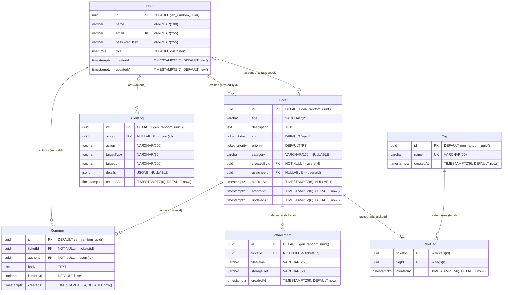

# SupportDesk — Database Entity Relationship Diagram (ERD)

This document provides the authoritative Entity Relationship Diagram (ERD) and relational schema specification for the SupportDesk application (Day 8).

**Source of Truth:** [`apps/api/prisma/schema.prisma`](../apps/api/prisma/schema.prisma)
**Target Engine:** PostgreSQL 17 (Prisma ORM 7.10.1)

---

## 1. Entity Relationship Diagram

> **Note on Polymorphic Audit Targets:** `AuditLog.targetType` and `AuditLog.targetId` represent an application-level polymorphic reference (e.g., targeting a `Ticket`, `User`, or `System` entity). No database-level foreign key constraint is enforced on `targetId`.

---

## 2. Model Specifications

### 2.1 `users`
Represents application accounts across all personas (customers, support agents, administrators).

| Column | PostgreSQL Type | Nullable | Constraints & Defaults | Description |
|---|---|:---:|---|---|
| `id` | `UUID` | No | `PRIMARY KEY`, `DEFAULT gen_random_uuid()` | Unique user identifier |
| `name` | `VARCHAR(100)` | No | — | Full display name |
| `email` | `VARCHAR(255)` | No | `UNIQUE` | Normalized lowercase email |
| `passwordHash` | `VARCHAR(255)` | No | — | Secure password hash |
| `role` | `user_role` (enum) | No | `DEFAULT 'customer'` | Permission role (`customer`, `agent`, `admin`) |
| `createdAt` | `TIMESTAMPTZ(6)` | No | `DEFAULT CURRENT_TIMESTAMP` | Account creation timestamp |
| `updatedAt` | `TIMESTAMPTZ(6)` | No | `DEFAULT CURRENT_TIMESTAMP` | Last profile update timestamp |

### 2.2 `tickets`
Central entity capturing customer support requests.

| Column | PostgreSQL Type | Nullable | Constraints & Defaults | Description |
|---|---|:---:|---|---|
| `id` | `UUID` | No | `PRIMARY KEY`, `DEFAULT gen_random_uuid()` | Unique ticket identifier |
| `title` | `VARCHAR(255)` | No | — | Brief issue summary |
| `description` | `TEXT` | No | — | Complete problem statement |
| `status` | `ticket_status` (enum) | No | `DEFAULT 'open'` | Lifecycle state |
| `priority` | `ticket_priority` (enum) | No | `DEFAULT 'P3'` | Urgency rating (`P1`, `P2`, `P3`, `P4`) |
| `category` | `VARCHAR(100)` | Yes | `NULL` | Functional domain (e.g., `Billing`, `API`) |
| `createdById` | `UUID` | No | `FOREIGN KEY -> users(id)` | Ticket creator |
| `assigneeId` | `UUID` | Yes | `FOREIGN KEY -> users(id)`, `NULL` | Assigned support staff |
| `slaDueAt` | `TIMESTAMPTZ(6)` | Yes | `NULL` | SLA resolution deadline |
| `createdAt` | `TIMESTAMPTZ(6)` | No | `DEFAULT CURRENT_TIMESTAMP` | Ticket creation timestamp |
| `updatedAt` | `TIMESTAMPTZ(6)` | No | `DEFAULT CURRENT_TIMESTAMP` | Last ticket modification timestamp |

### 2.3 `comments`
Message thread records for customer communication and internal agent collaboration.

| Column | PostgreSQL Type | Nullable | Constraints & Defaults | Description |
|---|---|:---:|---|---|
| `id` | `UUID` | No | `PRIMARY KEY`, `DEFAULT gen_random_uuid()` | Unique comment identifier |
| `ticketId` | `UUID` | No | `FOREIGN KEY -> tickets(id)` | Parent ticket |
| `authorId` | `UUID` | No | `FOREIGN KEY -> users(id)` | Message author |
| `body` | `TEXT` | No | — | Message content |
| `isInternal` | `BOOLEAN` | No | `DEFAULT false` | `true` for private staff notes |
| `createdAt` | `TIMESTAMPTZ(6)` | No | `DEFAULT CURRENT_TIMESTAMP` | Publication timestamp |

### 2.4 `tags`
Reusable taxonomic labels for ticket organization.

| Column | PostgreSQL Type | Nullable | Constraints & Defaults | Description |
|---|---|:---:|---|---|
| `id` | `UUID` | No | `PRIMARY KEY`, `DEFAULT gen_random_uuid()` | Unique tag identifier |
| `name` | `VARCHAR(50)` | No | `UNIQUE` | Normalized lowercase tag name |
| `createdAt` | `TIMESTAMPTZ(6)` | No | `DEFAULT CURRENT_TIMESTAMP` | Tag creation timestamp |

### 2.5 `ticket_tags`
Join table establishing the many-to-many relationship between tickets and tags.

| Column | PostgreSQL Type | Nullable | Constraints & Defaults | Description |
|---|---|:---:|---|---|
| `ticketId` | `UUID` | No | `PRIMARY KEY`, `FOREIGN KEY -> tickets(id)` | Reference to ticket |
| `tagId` | `UUID` | No | `PRIMARY KEY`, `FOREIGN KEY -> tags(id)` | Reference to tag |
| `createdAt` | `TIMESTAMPTZ(6)` | No | `DEFAULT CURRENT_TIMESTAMP` | Association timestamp |

### 2.6 `attachments`
Metadata references for files associated with tickets.

| Column | PostgreSQL Type | Nullable | Constraints & Defaults | Description |
|---|---|:---:|---|---|
| `id` | `UUID` | No | `PRIMARY KEY`, `DEFAULT gen_random_uuid()` | Unique attachment identifier |
| `ticketId` | `UUID` | No | `FOREIGN KEY -> tickets(id)` | Parent ticket |
| `fileName` | `VARCHAR(255)` | No | — | Original file name |
| `storageRef` | `VARCHAR(500)` | No | — | Storage URI or object key |
| `createdAt` | `TIMESTAMPTZ(6)` | No | `DEFAULT CURRENT_TIMESTAMP` | Upload timestamp |

### 2.7 `audit_logs`
Immutable record of system and user events.

| Column | PostgreSQL Type | Nullable | Constraints & Defaults | Description |
|---|---|:---:|---|---|
| `id` | `UUID` | No | `PRIMARY KEY`, `DEFAULT gen_random_uuid()` | Unique audit event identifier |
| `actorId` | `UUID` | Yes | `FOREIGN KEY -> users(id)`, `NULL` | Acting user (`NULL` for automated system tasks) |
| `action` | `VARCHAR(100)` | No | — | Event name (e.g., `ticket.created`, `seed.completed`) |
| `targetType` | `VARCHAR(50)` | No | — | Polymorphic entity kind (`Ticket`, `User`, `System`) |
| `targetId` | `VARCHAR(100)` | No | — | Identifier of targeted entity |
| `details` | `JSONB` | Yes | `NULL` | Structured contextual metadata |
| `createdAt` | `TIMESTAMPTZ(6)` | No | `DEFAULT CURRENT_TIMESTAMP` | Event timestamp |

---

## 3. Relationships & Referential Actions

| Parent Model | Child Model | Foreign Key | Cardinality | ON DELETE Action | Rationale |
|---|---|---|:---:|:---:|---|
| `User` | `Ticket` | `Ticket.createdById` | `1 : 0..N` | `RESTRICT` | Preserve ticket history; users with created tickets cannot be hard-deleted. |
| `User` | `Ticket` | `Ticket.assigneeId` | `0..1 : 0..N` | `SET NULL` | If an assigned agent account is removed, tickets remain open and become unassigned. |
| `User` | `Comment` | `Comment.authorId` | `1 : 0..N` | `RESTRICT` | Audit trail protection; comment authors cannot be deleted while messages exist. |
| `User` | `AuditLog` | `AuditLog.actorId` | `0..1 : 0..N` | `SET NULL` | Audit records must persist permanently even if actor accounts are deactivated. |
| `Ticket` | `Comment` | `Comment.ticketId` | `1 : 0..N` | `RESTRICT` | Prevents accidental cascading loss of conversation history. |
| `Ticket` | `Attachment` | `Attachment.ticketId` | `1 : 0..N` | `RESTRICT` | Prevents deletion of tickets with active file attachments without explicit de-linking. |
| `Ticket` | `TicketTag` | `TicketTag.ticketId` | `1 : 0..N` | `CASCADE` | Removing a ticket automatically clears its tag association join records. |
| `Tag` | `TicketTag` | `TicketTag.tagId` | `1 : 0..N` | `RESTRICT` | Active tags cannot be deleted while linked to existing tickets. |

---

## 4. Enumerations

### 4.1 `user_role`
Mapped from TypeScript `UserRole`:
- `CUSTOMER` → DB value `'customer'`
- `AGENT` → DB value `'agent'`
- `ADMIN` → DB value `'admin'`

### 4.2 `ticket_status`
Mapped from TypeScript `TicketStatus`:
- `OPEN` → DB value `'open'`
- `IN_PROGRESS` → DB value `'in_progress'`
- `WAITING_ON_CUSTOMER` → DB value `'waiting_on_customer'`
- `RESOLVED` → DB value `'resolved'`
- `CLOSED` → DB value `'closed'`

### 4.3 `ticket_priority`
Mapped from TypeScript `TicketPriority`:
- `P1` → DB value `'P1'` (Critical)
- `P2` → DB value `'P2'` (High)
- `P3` → DB value `'P3'` (Medium)
- `P4` → DB value `'P4'` (Low)

---

## 5. Performance Indexes

| Table | Index Name | Columns / Expressions | Type | Optimization Target |
|---|---|---|:---:|---|
| `users` | `users_email_key` | `(email)` | UNIQUE | Fast user lookup by email & duplicate prevention |
| `tickets` | `tickets_status_idx` | `(status)` | BTREE | Filtering queues by lifecycle state |
| `tickets` | `tickets_assignee_idx` | `(assigneeId)` | BTREE | Agent-specific dashboard views |
| `tickets` | `tickets_created_by_idx` | `(createdById)` | BTREE | Customer portal view of own tickets |
| `comments` | `comments_ticket_created_idx` | `(ticketId, createdAt ASC)` | BTREE | Composite chronological message rendering |
| `tags` | `tags_name_key` | `(name)` | UNIQUE | Tag normalization & fast lookup |
| `ticket_tags` | `ticket_tags_pkey` | `(ticketId, tagId)` | PRIMARY KEY | Composite unique constraint |
| `ticket_tags` | `ticket_tags_tag_idx` | `(tagId)` | BTREE | Reverse lookup: finding all tickets for a tag |
| `attachments` | `attachments_ticket_idx` | `(ticketId)` | BTREE | Loading ticket attachments |
| `audit_logs` | `audit_logs_target_idx` | `(targetType, targetId)` | BTREE | Polymorphic history queries for specific entities |
