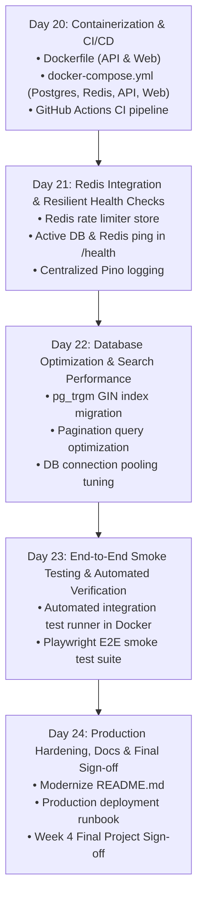

# SupportDesk Day 19 — Week 4 Preparation & Production Readiness Audit

> **Document:** Production Readiness Audit & Week 4 Strategic Plan  
> **Date:** Friday, 20 November 2026  
> **Repository:** SupportDesk (Monorepo: `apps/api`, `apps/web`)  
> **Auditor:** Assistant (Antigravity Agent)  
> **Status:** Completed (READ-ONLY Audit)

---

## 1. Executive Summary

SupportDesk has reached the conclusion of Week 3 with a fully functional end-to-end full-stack implementation. The system delivers customer ticket submission, agent ticket management, comments with role-based internal note visibility, real-time AI reply suggestions via Server-Sent Events (SSE), and structured AI ticket auto-categorisation with a multi-layered guardrail defense architecture.

This Day 19 audit assesses the production readiness of SupportDesk across **eight key operational dimensions** before moving into Week 4. While core business logic, role-based access control, tenant isolation, input guardrails, and AI safety features demonstrate high maturity and pass automated unit/guardrail testing (183 frontend tests passing, 99 AI & unit tests passing, zero TypeScript errors, clean production builds), several technical debt items and infrastructure prerequisites must be addressed before SupportDesk can be deemed production-ready.

### High-Level Audit Findings
- **Core Functionality:** High degree of architectural cleanliness. Layered MVC design in Express, reactive queries and optimistic UI updates in React, robust Zod validation across boundary layers.
- **AI Safety & Guardrails:** Strong defensive posture. Multi-layer input limits, PII sanitisation (including Indian PAN, Aadhaar, bank accounts, mobile numbers), context boundary isolation (`<ticket_data>`), structured output validation, and graceful fallbacks.
- **Key Production Blockers (to resolve in Week 4):**
  1. *Infrastructure & CI/CD:* No automated GitHub Actions workflow exists; `.github/workflows/` and `infra/` are empty. Integration tests require a live PostgreSQL database and fail in CI environments without container orchestration.
  2. *Distributed Rate Limiting & Caching:* The API rate limiters currently use in-memory stores (`express-rate-limit` default MemoryStore), which do not persist across multiple container replicas.
  3. *Stateless JWT Lifecycle:* Tokens have a fixed 24-hour expiration with no server-side revocation list, token blocklist, or refresh-token rotation mechanism.
  4. *Documentation Drift:* The root `README.md` is an outdated draft from October 2026 that still describes AI features as non-goals.

---

## 2. Repository and PR Status

### Git State Verification
- **Current Branch:** `feat/day-17-ai-guardrails`
- **Head Commit:** `85ca6b0` (`feat(demo): complete full-stack demo runbook, AI documentation, and week 3 sign-off`)
- **Base Branch:** `feat/day-16-ai-features`
- **Open Pull Request:** PR #23 (`feat/day-17-ai-guardrails` $\rightarrow$ `feat/day-16-ai-features`)
- **Working Tree State:** Clean (only untracked test fixture `supportdesk_messy_express_demo.js` is present and preserved intact).
- **Recent Git History:**
  - `85ca6b0` feat(demo): complete full-stack demo runbook, AI documentation, and week 3 sign-off
  - `887a391` feat(ai): implement AI guardrails, PII masking, rate limiting, and evaluation suite (Day 17)
  - `97cf228` feat(ai): implement AI features inside SupportDesk (Day 16)
  - `f18f72a` docs(supportdesk): finalize day 15 verification reports
  - `e7761b6` feat(web): implement create ticket screen and submission flow

### Monorepo Structure
```
SupportDesk/
├── .github/
│   └── workflows/
│       └── .gitkeep              <-- No automated CI pipeline defined
├── apps/
│   ├── api/                      <-- Express 5, Prisma 7, PostgreSQL, Zod, Jest
│   │   ├── prisma/
│   │   │   ├── migrations/       <-- Baseline migration (20261106043616_init)
│   │   │   ├── schema.prisma     <-- Relational schema (Users, Tickets, Comments, Tags, AuditLogs)
│   │   │   └── seed.ts           <-- Demo dataset seeder
│   │   ├── src/
│   │   │   ├── ai/               <-- Gemini client, prompts, guardrails, evaluation harness
│   │   │   ├── controllers/      <-- Auth, Tickets, Comments, AI controllers
│   │   │   ├── middleware/       <-- Auth, RBAC, Rate limiter, Error handler, Logger
│   │   │   ├── repositories/     <-- Data access layer with tenant isolation
│   │   │   └── services/         <-- Domain business logic
│   │   └── tests/                <-- Jest and Node test runner suites
│   └── web/                      <-- React 18, Vite 6, TanStack Query, Tailwind CSS, Vitest
│       ├── src/
│       │   ├── components/       <-- Accessible UI library (Alert, Badge, Modal, Table, etc.)
│       │   ├── features/tickets/ <-- Ticket list, detail, create, comments, AI hooks & api
│       │   ├── lib/              <-- Auth provider, sessionStorage persistence, api-client
│       │   └── pages/            <-- Routed view containers (Login, Dashboard, Detail, Create)
│       └── tests/                <-- Vitest component & integration test suites
├── docs/                         <-- Architecture, database design, AI spec, sprint reports
├── infra/
│   └── .gitkeep                  <-- Empty: missing Dockerfile and docker-compose.yml
└── README.md                     <-- Outdated October 2026 baseline draft
```

---

## 3. Backend Audit (`apps/api`)

### 3.1 Authentication & Authorization
- **Implementation:** Stateless JWT Bearer tokens signed with HMAC-SHA256 (`jsonwebtoken`), validated via `authenticate` middleware.
- **Role-Based Access Control (RBAC):** Middleware factory `authorize(...allowedRoles: UserRole[])` enforces role boundaries (`CUSTOMER`, `AGENT`, `ADMIN`).
- **Strengths:**
  - Token signature and expiration are rigorously validated.
  - Role hierarchy is strictly enforced on all sensitive routes (e.g. AI routes reject `CUSTOMER` with 403 Forbidden).
  - Authenticated user context (`id`, `email`, `role`) is extracted directly from the verified JWT payload and attached to `req.user`.
- **Gaps / Technical Debt:**
  - **No Server-Side Token Revocation:** Because JWTs are stateless without a Redis token blocklist or database session store, a compromised token remains valid until its 24-hour expiration (`JWT_EXPIRES_IN=1d`).
  - **No Refresh Token Flow:** When the token expires, the user must re-enter credentials. There is no silent refresh mechanism.

### 3.2 Tenant Isolation & Data Access Security
- **Implementation:** Filter predicates embedded directly inside `TicketsService` and `CommentsService`:
  - `listTickets()`: If `user.role === UserRole.CUSTOMER`, query is strictly restricted to `createdById: user.id`. Customers cannot enumerate other users' tickets.
  - `getTicketById()`: If `user.role === UserRole.CUSTOMER` and `ticket.createdById !== user.id`, throws `NotFoundError("Ticket not found")` (prevents ID enumeration or resource discovery).
  - `createComment()`: If `user.role === UserRole.CUSTOMER` and `ticket.createdById !== user.id`, throws `NotFoundError`.
  - `listComments()`: Internal comments (`isInternal: true`) are filtered out at the repository level unless the user is an `AGENT` or `ADMIN`. Customers never receive internal staff discussions.
  - **Ownership Guarantee:** `createdById` and `authorId` are always assigned from `req.user.id`; client request bodies cannot spoof ticket creator or comment author identities.

### 3.3 AI Endpoints & Guardrails
- **Endpoints:**
  - `POST /api/v1/tickets/:id/ai/suggest-reply`: Streams response tokens via SSE.
  - `POST /api/v1/tickets/:id/ai/categorize`: Returns structured JSON triage proposals.
- **Guardrails:**
  - **Input Limits:** Title truncated to 255 chars, description to 2,000 chars, max 5 recent public comments, each comment truncated to 1,000 chars. Oversized agent instructions rejected (>500 chars).
  - **Content Moderation:** In-memory keyword/pattern blocklist executed on ticket title, description, public comments, and agent instructions prior to AI provider dispatch.
  - **PII Masking:** Sanitises Indian PAN, 12-digit Aadhaar, 9–18 digit bank account numbers, 10-digit mobile numbers (+91 / 0 prefixes), payment cards, JWT tokens, API keys, and IPv4 addresses into standard redaction tags (`[REDACTED_PAN]`, etc.).
  - **Context Isolation:** Untrusted ticket data is enclosed in `<ticket_data>` XML tags with explicit delimiter breakout neutralizing and system prompt instructions ordering the model to treat ticket content strictly as passive data.
  - **Output Validation:** Auto-categorisation responses are validated through Zod schema (`categoryPriorityResponseSchema`). Malformed JSON or schema mismatches trigger a controlled 502 Bad Gateway rather than application crashes.
  - **Rate Limiting:** Dedicated per-user rate limiter (`aiRateLimiter`) caps requests at 10 requests/minute per authenticated user, returning HTTP 429.

### 3.4 Error Handling & Logging
- **Standard Envelope:** Uniform JSON envelope across all endpoints: `{ data, error, meta }`.
- **Global Error Handler:** Catches operational errors (`AppError`, `ZodError`, `JsonWebTokenError`, `PrismaClientKnownRequestError`) and converts them into standardized error payloads without leaking database stack traces or internal environment variables.
- **Gaps / Technical Debt:**
  - Logging is performed via `console.log` and `console.info` with custom JSON format. It lacks a centralized logging framework (such as Winston or Pino) that supports log rotation, correlation IDs across micro-hops, and external log aggregator shipping (Datadog, CloudWatch, etc.).

### 3.5 Database & Prisma
- **ORM:** Prisma 7.10.1 with PostgreSQL adapter.
- **Models:** Cleanly defined models (`User`, `Ticket`, `Comment`, `Tag`, `TicketTag`, `Attachment`, `AuditLog`).
- **Indexes:** Composite index on `Comment (ticketId, createdAt ASC)`, single index on `Ticket (status)`, `Ticket (assigneeId)`, and `Ticket (createdById)`.
- **Gaps / Technical Debt:**
  - Text search on tickets uses Prisma `contains: search, mode: "insensitive"` which compiles to PostgreSQL `ILIKE %search%`. This performs sequential table scans on large tables. Needs a PostgreSQL GIN trigram index (`pg_trgm`) or full-text search index (`tsvector`).

---

## 4. Frontend Audit (`apps/web`)

### 4.1 Routing & Session Management
- **Protected Routes:** `ProtectedRoute` guards all dashboard and ticket views, displaying an accessible loading spinner during session restoration and redirecting unauthenticated users to `/login`.
- **Session Storage:** Tokens and user metadata are stored in browser `sessionStorage`. An event-based `onUnauthorized` hook automatically clears storage and forces a redirect to `/login` upon any HTTP 401 response.
- **Trade-off:** `sessionStorage` avoids CSRF vulnerabilities inherent to default cookie authentication without requiring CSRF token choreography. However, tokens stored in Web Storage are accessible to JavaScript and therefore susceptible to token theft if an XSS vulnerability exists.

### 4.2 Workflows & Feature Completeness
- **Customer Workflow:** Clean ticket creation form with live client-side validation (title min 5 chars, description min 10 chars, valid priority and category selects).
- **Agent Dashboard:** Complete ticket table with pagination, debounced search, status filtering (`OPEN`, `IN_PROGRESS`, etc.), priority badges, and quick status action modals.
- **Ticket Detail & Comments:** Interactive comment stream displaying author avatars, timestamps, and badges. Amber badges visually distinguish private internal notes from public comments.
- **AI Suggest Reply:** Streams tokens into an editable textarea draft buffer via SSE. Staff can review, modify, or discard the draft before publishing as a public comment. **AI never auto-sends.**
- **AI Auto-Categorisation:** Displays proposed category and priority alongside model confidence and reasoning in a review panel. Staff must click "Apply" to persist changes to the ticket. **AI never mutates the database autonomously.**

### 4.3 UI States, Responsiveness & Accessibility
- **State Handling:** Skeletons and spinners for loading states, empty search illustrations for zero-result states, clear validation error feedback under inputs, and alert banners for network failures.
- **Accessibility:** Uses semantic HTML (`<main>`, `<nav>`, `<header>`, `<article>`), ARIA live regions (`role="status"`, `aria-live="polite"`), accessible form labels with `htmlFor`, and WCAG AA compliant color contrast.

---

## 5. Security and Privacy Audit

| Security Layer | Implementation | Assessment | Recommendations |
| :--- | :--- | :--- | :--- |
| **HTTP Perimeter** | `helmet()` with CSP and secure headers; CORS configured with origin whitelist. | **PASS** | Keep production CORS origin restricted to approved frontend domain. |
| **Authentication** | JWT Bearer tokens signed with 32+ char secret, verified per request. | **NEEDS IMPROVEMENT** | Implement refresh token rotation and server-side token blocklist (Redis). |
| **Authorization (RBAC)** | Strict role enforcement (`CUSTOMER`, `AGENT`, `ADMIN`) on all API routers. | **PASS** | Role boundaries verified through comprehensive tests. |
| **Tenant Isolation** | Customer ticket/comment queries filtered by `createdById = user.id`; 404 on unowned resource access. | **PASS** | Prevents ID enumeration and cross-customer data leakage. |
| **Rate Limiting** | Auth rate limit (5 attempts / 15 min); AI rate limit (10 req / min per user). | **NEEDS IMPROVEMENT** | In-memory limiter will not synchronize across multiple API server replicas; migrate to Redis. |
| **Prompt Injection** | Delimiter isolation (`<ticket_data>`), length truncation, system instructions. | **PASS** | Passes all 10 synthetic injection attack fixtures. |
| **PII Protection** | Regex sanitizer masks PAN, Aadhaar, bank accounts, phones, cards, and keys. | **PASS** | Zero unmasked identifiers sent to AI provider. |
| **Output Integrity** | Zod schema validation ensures only expected JSON shapes are consumed by services. | **PASS** | Prevents prompt hijacking from injecting arbitrary payloads into DB. |

---

## 6. Testing & Quality Audit

### Verified Test Results (Recorded Locally)

```bash
# 1. Frontend Test Suite (Vitest)
npm --prefix apps/web test
# Results:
# Test Files: 12 passed (12)
# Tests:      183 passed (183)
# Duration:   2.64s

# 2. Backend AI & Guardrail Suites (Jest)
npm --prefix apps/api run test:jest -- tests/ai.guardrails.spec.ts tests/ai.feature.spec.ts tests/gemini.client.spec.ts tests/ai.evaluation.spec.ts
# Results:
# Test Suites: 4 passed, 4 total
# Tests:       99 passed, 99 total
# Duration:    0.62s

# 3. Documentation HTTP Endpoint Tests (Jest)
npm --prefix apps/api run test:jest -- tests/docs.spec.ts
# Results:
# Test Suites: 1 passed, 1 total
# Tests:       11 passed, 11 total

# 4. Frontend Typecheck
npm --prefix apps/web run typecheck
# Results: tsc --noEmit -> Exit code 0 (0 errors)

# 5. Frontend Production Build
npm --prefix apps/web run build
# Results: dist/index.html (0.36 kB gzip), dist/assets/index.js (134.48 kB gzip) -> Exit code 0

# 6. Backend Typecheck
npm --prefix apps/api run typecheck
# Results: tsc --noEmit && typecheck:seed -> Exit code 0 (0 errors)

# 7. Backend Production Build
npm --prefix apps/api run build
# Results: tsc -p tsconfig.json -> Exit code 0 (0 errors)
```

### Integration Test Analysis
- Running `npm --prefix apps/api test` (full suite including `tests/integration.spec.ts` and `tests/api.test.ts`) requires a live PostgreSQL instance running on `supportdesk_test`.
- In environments where PostgreSQL is not currently running locally, these integration tests fail with `PrismaClientKnownRequestError: ECONNREFUSED`.
- **Finding:** Integration tests lack an automated containerized test runner (such as `testcontainers` or Docker Compose service). While unit tests and AI tests mock database calls and pass 100%, end-to-end API integration tests cannot run unattended without active database infrastructure.

---

## 7. Documentation Audit

| Document | Location | Status | Action Needed |
| :--- | :--- | :--- | :--- |
| **Root README** | `README.md` | **OUTDATED** | Outdated draft from 22 October 2026. Needs update with modern monorepo instructions, AI feature guide, and setup commands. |
| **AI Features Spec** | `docs/ai-features.md` | **COMPLETE** | Comprehensive architecture, schemas, prompts, and guardrail documentation authored in Day 18. |
| **Demo Runbook** | `docs/week-3/full-stack-demo-runbook.md` | **COMPLETE** | Step-by-step walkthrough covering 10-item demo flow. |
| **Database Design** | `docs/database-design-notes.md` | **COMPLETE** | Baseline relational design, schema notes, and ERD. |
| **Prompt Journal** | `docs/prompt-journal.md` | **COMPLETE** | 24 entries recorded through Day 18 sign-off. |
| **Deployment / Infra** | `infra/` | **MISSING** | No Dockerfile, docker-compose.yml, or deployment runbook. |
| **CI/CD Workflow** | `.github/workflows/` | **MISSING** | No GitHub Actions workflow file to run automated checks on PRs. |

---

## 8. Production Readiness Scorecard

| Category | Rating | Justification & Evidence |
| :--- | :---: | :--- |
| **1. Security** | **NEEDS IMPROVEMENT** | Strong RBAC, tenant isolation, PII sanitization, and input guardrails. However, rate limiting is currently in-memory (fails in multi-replica deployments) and JWTs lack server-side revocation / refresh rotation. |
| **2. Reliability** | **NEEDS IMPROVEMENT** | Graceful fallbacks exist for AI failures (`AI unavailable — reply manually.`), but database health checks do not ping PostgreSQL, and there is no automated retry logic for transient database disconnects. |
| **3. Maintainability** | **PASS** | Clean MVC architecture in Express, strict TypeScript compilation with zero errors across both apps, Zod schema validation at all I/O boundaries, and modular component hierarchy. |
| **4. Scalability** | **NEEDS IMPROVEMENT** | API server is mostly stateless, but in-memory rate limiting binds state to individual process memory. Ticket search uses unindexed `ILIKE` substring matching which does not scale past thousands of records. |
| **5. Performance** | **PASS** | Frontend bundle size is compact (134 kB gzip for full app). Fast initial render. Composite index on `comments(ticketId, createdAt)` ensures $O(\log N)$ thread retrieval. |
| **6. Accessibility** | **PASS** | WCAG AA color contrast, semantic HTML5 structure, ARIA live announcements on streaming AI outputs and loading states, full keyboard navigability. |
| **7. Testing** | **NEEDS IMPROVEMENT** | Excellent unit and guardrail coverage (183 web tests, 99 AI & unit tests passing). However, integration tests require manual PostgreSQL setup and fail without local DB; no automated CI pipeline runs tests on PR push. |
| **8. Documentation** | **NEEDS IMPROVEMENT** | Sprint reports, demo runbook, AI specifications, and prompt journal are thorough and complete. However, root `README.md` is obsolete and no Docker/deployment runbook exists. |

---

## 9. Prioritized Issues Matrix

### Critical Priority (Must Fix Before Production Launch)
1. **Automated CI/CD Pipeline:** Create `.github/workflows/ci.yml` running linting, typechecks, frontend Vitest suite, and containerized backend integration tests on all PRs.
2. **Containerization & Deployment Setup:** Author `Dockerfile` for `apps/api` and `apps/web`, plus a root `docker-compose.yml` defining PostgreSQL, API, Web, and Redis services.

### High Priority (Week 4 Focus)
3. **Distributed Rate Limiting (Redis):** Replace in-memory `express-rate-limit` stores with `rate-limit-redis` so rate limits (auth and AI endpoints) are shared across clustered server instances.
4. **Active Database Health Check:** Update `/health` route to perform a live `prisma.$queryRaw\`SELECT 1\`` ping, returning 503 if the database connection pool drops.
5. **Modernize Root README:** Overwrite `README.md` with accurate monorepo setup commands, environment variables, architecture diagrams, and AI feature instructions.

### Medium Priority
6. **PostgreSQL Trigram Search Index:** Add a Prisma migration creating a GIN index on `tickets(title, description)` using `pg_trgm` to optimize search performance.
7. **Production Logging Framework:** Replace `console.log` with a structured logger (such as Pino) supporting log levels, correlation IDs, and JSON output formatting.
8. **Server-Side Token Revocation / Refresh Flow:** Implement refresh token rotation in database or Redis to reduce access token lifespan from 24h to 15m.

### Low Priority / Future Enhancements
9. **Automated End-to-End Tests:** Add Playwright or Cypress tests verifying full browser workflows in an automated headless environment.
10. **Email Notifications / Webhooks:** Integrate email notifications on ticket assignment or customer comment.

---

## 10. Recommended Day 20–24 Implementation Plan



- **Day 20 — Containerization & CI Pipeline:**
  - Create multi-stage production Dockerfiles for `apps/api` and `apps/web`.
  - Create root `docker-compose.yml` orchestrating PostgreSQL 16, Redis, backend, and frontend.
  - Set up `.github/workflows/ci.yml` running lint, typecheck, Vitest, and Jest against a PostgreSQL service container.
- **Day 21 — Infrastructure Resilience (Redis & Health Checks):**
  - Connect Redis store for login and AI rate limiters.
  - Implement active database & cache ping in `/health`.
  - Implement structured logging with Pino.
- **Day 22 — Database Optimization & Security Hardening:**
  - Add PostgreSQL GIN trigram index migration for ticket text search.
  - Implement short-lived access tokens (15m) with refresh token rotation.
- **Day 23 — E2E Smoke Tests & Verification:**
  - Validate containerized environment end-to-end.
  - Verify that both customer and agent workflows function cleanly within Docker Compose.
- **Day 24 — Final Production Documentation & Delivery:**
  - Update root `README.md` with complete setup and architecture guide.
  - Author production deployment runbook.
  - Final project review and handover.
