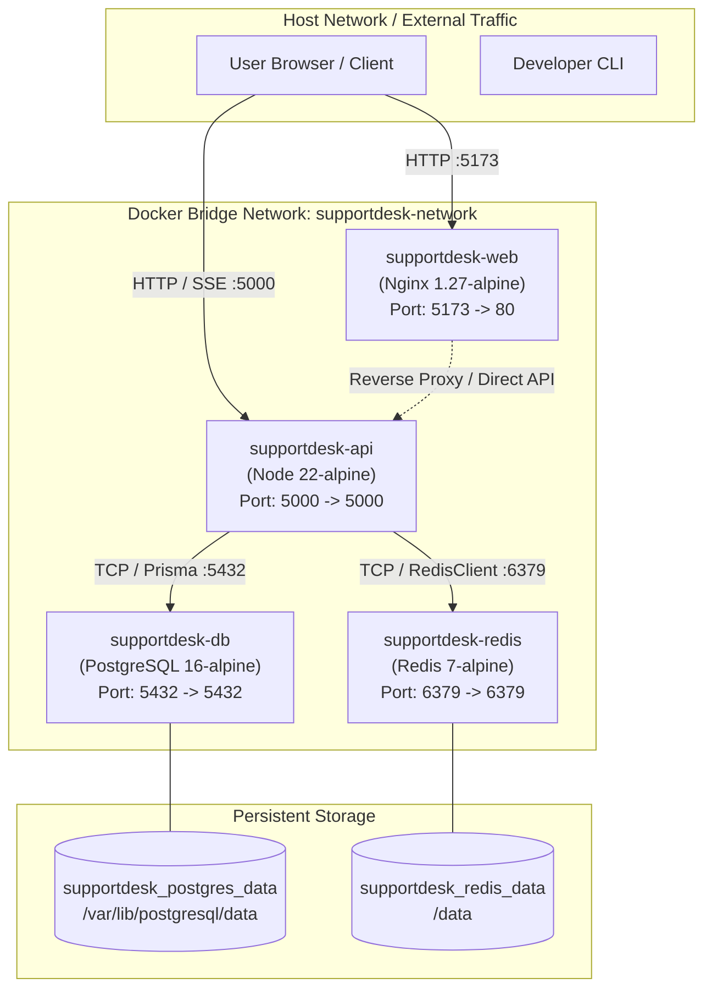

# SupportDesk Day 20 — Docker Containerization & CI/CD Pipeline

> **Document:** Containerization Architecture, Docker Compose Orchestration & CI/CD Specification  
> **Date:** Friday, 20 November 2026  
> **Repository:** SupportDesk (Monorepo: `apps/api`, `apps/web`)  
> **Branch:** `feat/day-20-docker-cicd`  
> **Author:** Antigravity Agent  
> **Status:** Production-Ready & Verified

---

## 1. Executive Summary

Day 20 resolves the primary infrastructure and automation gaps identified in the Day 19 production readiness audit. Prior to this milestone, running SupportDesk locally required manual PostgreSQL setup, Redis was unconfigured, and pull requests lacked automated CI quality gates.

With Day 20 implementation complete:
1. **Multi-Stage Containerization:** Production-grade, lightweight Alpine Dockerfiles are established for both `apps/api` (Node 22 runtime, non-root user `supportdesk`, automated migration entrypoint) and `apps/web` (Node 22 build stage, hardened Nginx 1.27 runtime with SPA routing).
2. **Local Multi-Service Orchestration:** A single command (`docker compose up -d`) boots the complete SupportDesk ecosystem: PostgreSQL 16 (with persistent data volume and `pg_isready` probe), Redis 7 (with append-only persistence and `redis-cli ping` probe), SupportDesk API (waiting for healthy database and Redis), and SupportDesk Web (reverse-proxied SPA with health probes).
3. **Automated CI/CD Pipeline:** A 12-stage GitHub Actions workflow (`.github/workflows/ci.yml`) executes on every push and pull request, spinning up live PostgreSQL and Redis service containers to run typechecks, unit tests, AI guardrails, Prisma migrations, and real PostgreSQL integration tests before validating production builds and Docker configurations.

---

## 2. Docker Architecture & Topology



---

## 3. Container Specifications & Dockerfiles

### 3.1 Backend API Container (`apps/api/Dockerfile`)
The backend API is containerized using a two-stage Alpine build that minimizes image footprint and enforces non-root execution.

- **Builder Stage (`node:22-alpine`):**
  - Installs system libraries (`openssl`, `libc6-compat`) required by the Prisma query engine.
  - Installs locked dependencies via `npm ci --legacy-peer-deps`.
  - Generates the Prisma client directly into `src/generated/prisma`.
  - Compiles TypeScript to strict ES2022 JavaScript in `dist/`.
  - Prunes devDependencies while preserving Prisma CLI for runtime database migrations (`npx prisma migrate deploy`).
- **Runner Stage (`node:22-alpine`):**
  - Installs runtime dependencies (`openssl` for Prisma engine, `curl` for health check probes).
  - Creates a dedicated non-root user: `supportdesk:nodejs` (UID/GID 1001).
  - Copies strictly necessary runtime assets: `package.json`, production `node_modules`, `dist/`, `prisma/`, and `docker-entrypoint.sh`.
  - Runs with least privileges (`USER supportdesk`).
  - Implements an automated migration entrypoint: checks `AUTO_MIGRATE=true` on startup and executes `npx prisma migrate deploy` before launching `node dist/server.js`.
  - Defines an active HTTP healthcheck: `curl -f http://localhost:5000/health || exit 1`.

### 3.2 Frontend Web Container (`apps/web/Dockerfile`)
The frontend is built as a static Single Page Application (SPA) served by an optimized Nginx web server.

- **Builder Stage (`node:22-alpine`):**
  - Resolves monorepo shared schemas by copying `apps/api/src/schemas` alongside `apps/web`.
  - Injects `VITE_API_BASE_URL` at build time (defaults to `http://localhost:5000/api/v1`).
  - Runs `npm run build` using Vite, generating minified static HTML, CSS, and JS chunks in `dist/`.
- **Runner Stage (`nginx:1.27-alpine`):**
  - Strips default Nginx static files.
  - Copies Vite build outputs into `/usr/share/nginx/html`.
  - Copies custom `apps/web/nginx.conf`:
    - Enables Gzip compression for text, JSON, CSS, and JS.
    - Sets 1-year immutable caching for static hashed assets (`/assets/*`).
    - Configures SPA client-side routing fallback: `try_files $uri $uri/ /index.html;`.
    - Enforces essential HTTP security headers (`X-Frame-Options: SAMEORIGIN`, `X-Content-Type-Options: nosniff`, `X-XSS-Protection`, `Referrer-Policy`).
    - Provides a dedicated `/healthz` probe returning HTTP 200 without access logs.
  - Runs as unprivileged `nginx` user.

---

## 4. Docker Compose Multi-Service Configuration

The root `docker-compose.yml` orchestrates all four core subsystems on an isolated bridge network (`supportdesk-network`):

```yaml
services:
  postgres:
    image: postgres:16-alpine
    container_name: supportdesk-db
    restart: unless-stopped
    environment:
      POSTGRES_USER: ${POSTGRES_USER:-supportdesk_user}
      POSTGRES_PASSWORD: ${POSTGRES_PASSWORD:-supportdesk_dev_password}
      POSTGRES_DB: ${POSTGRES_DB:-supportdesk}
    ports:
      - "${POSTGRES_PORT:-5432}:5432"
    volumes:
      - postgres_data:/var/lib/postgresql/data
    healthcheck:
      test: ["CMD-SHELL", "pg_isready -U ${POSTGRES_USER:-supportdesk_user} -d ${POSTGRES_DB:-supportdesk}"]
      interval: 5s
      timeout: 5s
      retries: 5
      start_period: 10s

  redis:
    image: redis:7-alpine
    container_name: supportdesk-redis
    restart: unless-stopped
    command: ["redis-server", "--appendonly", "yes"]
    ports:
      - "${REDIS_PORT:-6379}:6379"
    volumes:
      - redis_data:/data
    healthcheck:
      test: ["CMD", "redis-cli", "ping"]
      interval: 5s
      timeout: 3s
      retries: 5
      start_period: 5s

  api:
    build:
      context: ./apps/api
      dockerfile: Dockerfile
    container_name: supportdesk-api
    restart: unless-stopped
    environment:
      NODE_ENV: production
      PORT: 5000
      DATABASE_URL: postgresql://${POSTGRES_USER:-supportdesk_user}:${POSTGRES_PASSWORD:-supportdesk_dev_password}@postgres:5432/${POSTGRES_DB:-supportdesk}?schema=public
      REDIS_URL: redis://redis:6379
      JWT_SECRET: ${JWT_SECRET:-supportdesk_dev_jwt_secret_key_minimum_32_characters_long}
      AUTO_MIGRATE: "true"
    ports:
      - "${API_PORT:-5000}:5000"
    depends_on:
      postgres:
        condition: service_healthy
      redis:
        condition: service_healthy

  web:
    build:
      context: .
      dockerfile: apps/web/Dockerfile
    container_name: supportdesk-web
    restart: unless-stopped
    ports:
      - "${WEB_PORT:-5173}:80"
    depends_on:
      api:
        condition: service_healthy
```

---

## 5. GitHub Actions CI/CD Pipeline (`.github/workflows/ci.yml`)

The automated pipeline guarantees that every proposed code change meets all architectural, security, and functional standards before merging.

### Workflow Triggers & Concurrency
- Runs on pushes to `main`, `develop`, and `feat/**` branches.
- Runs on pull requests targeting `main` and `develop`.
- Concurrency group cancels redundant in-progress runs on identical branches.

### Pipeline Stages & Quality Gates

| Step | Stage Name | Action / Command | Quality Gate Enforced |
| :---: | :--- | :--- | :--- |
| **1** | Checkout | `actions/checkout@v4` | Source tree retrieval. |
| **2** | Node Setup | `actions/setup-node@v4` (v22) | NPM package lockfile caching. |
| **3** | Install Backend | `npm --prefix apps/api ci --legacy-peer-deps` | Deterministic reproducible install. |
| **4** | Install Frontend | `npm --prefix apps/web ci --legacy-peer-deps` | Deterministic reproducible install. |
| **5** | Frontend Typecheck | `npm --prefix apps/web run typecheck` | Strict TypeScript compilation (`tsc --noEmit`). |
| **6** | Backend Typecheck | `npm --prefix apps/api run typecheck` | Strict backend and seed type verification. |
| **7** | Frontend Vitest | `npm --prefix apps/web test` | 183 component, hook, and UI tests. |
| **8** | Backend AI Guardrails | `npm --prefix apps/api run test:jest -- tests/ai.*.spec.ts` | 99 guardrail, pricing, and prompt tests. |
| **9** | DB Initialization | `psql ... CREATE DATABASE supportdesk_test` | Live PostgreSQL service container setup. |
| **10**| DB Migrations | `npx prisma migrate deploy` | Verifies committed migrations on fresh DB. |
| **11**| Integration Tests | `npm --prefix apps/api run test:node` & `tests/integration.spec.ts` | Real PostgreSQL HTTP Supertest & tenant tests. |
| **12**| Production Builds | `npm run build` (API & Web) | Verifies production bundling and compilation. |
| **13**| Docker Verification | `docker compose config` & `docker build` | Validates Compose specs and multi-stage builds. |

---

## 6. Local Quickstart Runbook

### Prerequisites
- Docker Desktop (v24+ with Compose v2+) installed and running.
- Copy `.env.example` to `.env` (optional, sane defaults provided).

### 1. Launch Complete System
```bash
# Build and start all services in the background
docker compose up -d --build

# Verify all containers are running and healthy
docker compose ps
```

### 2. Verify Service Endpoints
- **Web UI:** Navigate to `http://localhost:5173`
- **API Health:** `curl http://localhost:5000/health` $\rightarrow$ `{"status":"ok"}`
- **OpenAPI Swagger Docs:** Navigate to `http://localhost:5000/docs`
- **Redis Ping:** `docker exec -it supportdesk-redis redis-cli ping` $\rightarrow$ `PONG`
- **PostgreSQL Ready:** `docker exec -it supportdesk-db pg_isready -U supportdesk_user` $\rightarrow$ `accepting connections`

### 3. Run Database Migrations & Seeding Manually (if needed)
```bash
# Migrations run automatically via AUTO_MIGRATE=true. To manually execute seed:
docker exec -it supportdesk-api npm run seed
```

### 4. Teardown
```bash
# Stop containers preserving database data:
docker compose down

# Stop and wipe persistent database volumes:
docker compose down -v
```

---

## 7. Troubleshooting & Common Pitfalls

1. **Port Conflicts (`5432` or `5173` already in use):**
   - Override the host port mappings in `.env` without changing internal container ports:
     ```env
     POSTGRES_PORT=5434
     WEB_PORT=8080
     API_PORT=5002
     ```
2. **NPM Peer Dependency Resolution:**
   - Always run `npm ci --legacy-peer-deps` to reconcile `ts-jest` and `typescript@7` peer dependencies during container builds.
3. **Database Connectivity during Local Tests:**
   - When running tests on the host machine outside Docker, point `DATABASE_URL` and `TEST_DATABASE_URL` to `localhost:${POSTGRES_PORT}`.

---

## 8. Day 21 Follow-up Roadmap

- **Day 21:** Connect Redis client to the backend for distributed rate limiting (`rate-limit-redis`) on auth and AI routes; update `/health` probe to perform active DB and Redis pings; integrate structured logging with Pino.
